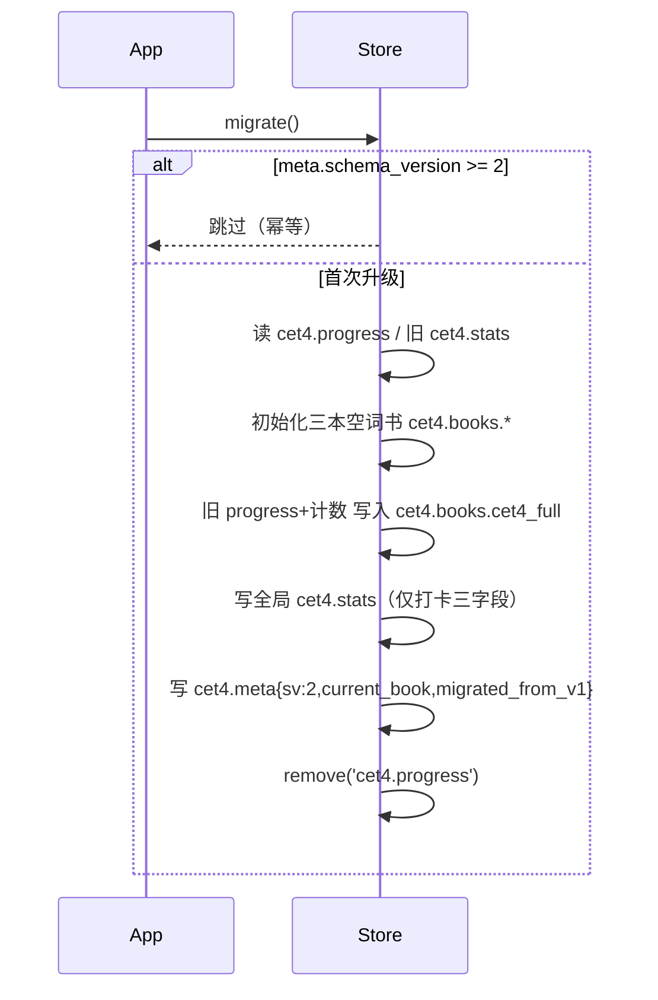
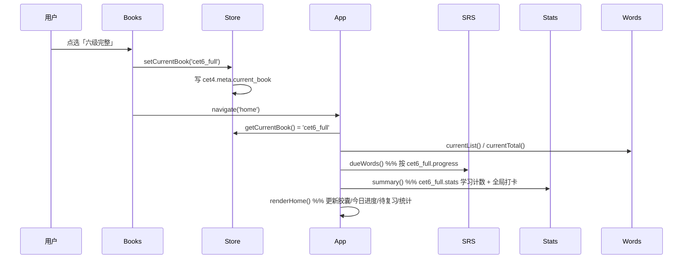
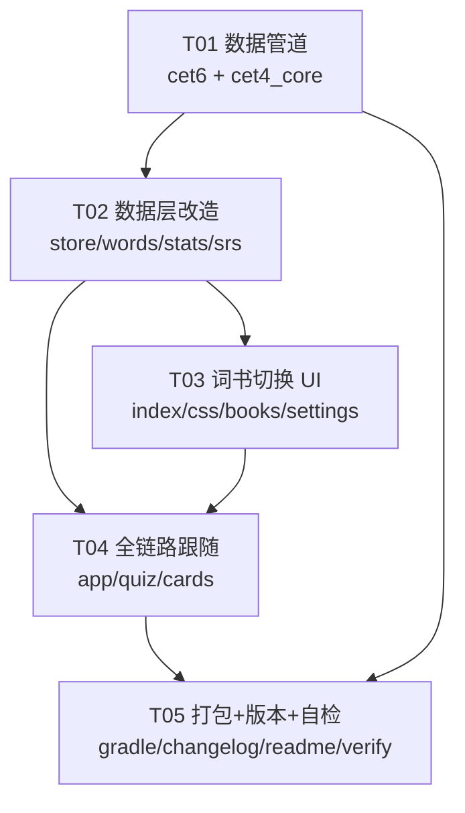
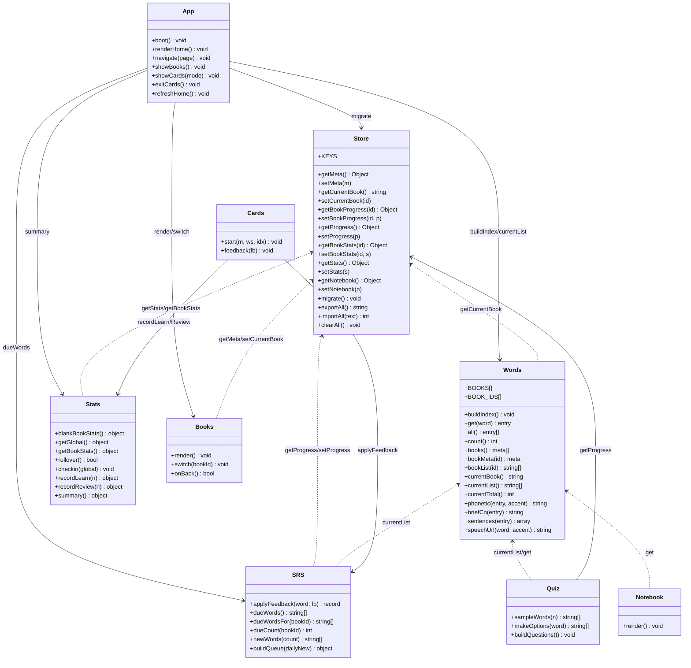
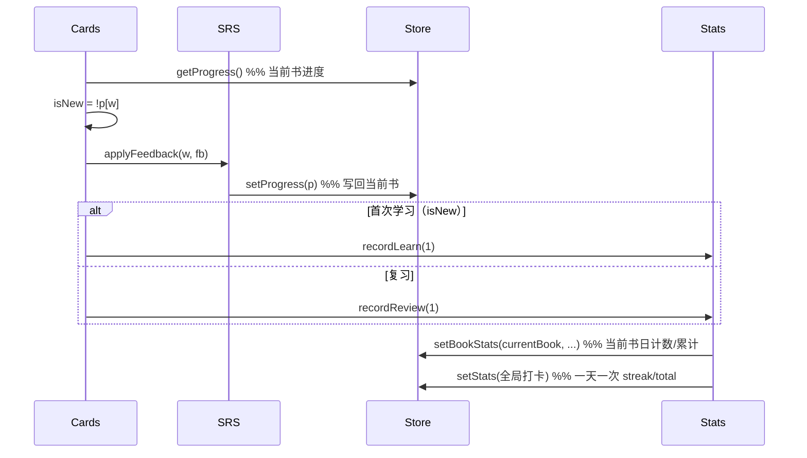

# 词书体系扩展 —— 架构设计 + 任务分解（v1.2.0）

> 基线：v1.1.1（WebView 混合应用，`app/src/main/assets/www/` 前端 + 纯 Java 壳）
> 本文档是 `docs/PRD-v1.2.0-books.md` 增量需求的架构落地，覆盖「三本词书 + 词书切换 + 老数据迁移」。
> 前置决策：版本 v1.2.0 / versionCode 10200；词书 ID 用稳定字符串 `cet4_core` / `cet4_full` / `cet6_full`。

---

## 目录

1. 实现方案（Implementation Approach）
2. 多词书数据文件组织 + 词书注册表
3. localStorage Schema（含迁移前后对照）
4. 老数据迁移流程
5. 词书切换数据流
6. 文件清单（新增 / 修改）
7. 任务列表（有序 + 依赖）
8. 共享知识（跨文件约定）
9. 待明确事项（Open Questions）

---

## 1. 实现方案（Implementation Approach）

### 1.1 核心难点

| 难点 | 说明 | 对策 |
| --- | --- | --- |
| 多词书并存，进度/复习/计数互相独立 | 现有 `cet4.progress` 是全局扁平 `word→record`，`cet4.stats` 是全局统计，无法区分「四级/六级」 | 存储层重构为 `cet4.books.{bookId}.{progress,stats}` + 全局 `cet4.stats`（仅打卡）；`Store.getProgress()/getStats()` 保留为「当前书」语义兼容壳 |
| 老数据零丢失迁移 | 老用户已学 4522 词，升级后不能重学 | 引入 `cet4.meta`（`schema_version` + `current_book`），启动时一次性迁移：旧 progress+stats 整体归入 `cet4_full`，`schema_version=2` 幂等标记 |
| 三套数据文件体积可控 | 内嵌 4522（CET4）+ 4000+（CET6）词条，APK 体积会膨胀 | 四级核心只存**有序词单字符串数组**（复用 cet4.js 词条，约 25KB）；CET6 复用现有精简字段（无 definition、每词 1 例句）控制体积 |
| 测试严格「仅当前书」 | 避免四六级选项混排 | `Quiz.sampleWords()` 与干扰项生成都从 `Words.currentList()` 取，不再用全局 `Words.all()` |
| 打卡全局、计数按书 | 「今天学任意书≥1词即打卡」+「每本书各按 daily_new 独立计数」 | 全局 `cet4.stats` 只存 `streak_days/total_checkin_days/last_checkin_date`；每书 `stats` 存 `total_learned/total_reviewed/daily_new_count/daily_review_count/daily_date` |

### 1.2 架构模式与分层（沿用现有，不引入框架）

沿用现有 **无框架 IIFE + 全局命名空间** 模式（`window.Store/Words/SRS/Stats/...`），不新增运行时依赖：

```
数据层（data/*.js 数据文件）
   ↓ window.CET4_WORDS / window.CET4_CORE_WORDS / window.CET6_WORDS
存储层（store.js：localStorage 封装 + 迁移 + 当前书语义壳）
   ↓
索引/词书注册层（words.js：全局词条索引 + 词书注册表 + currentList）
   ↓
算法层（srs.js 排期 / stats.js 统计打卡，均按「当前书」取数）
   ↓
页面层（app.js 路由 / cards.js / quiz.js / notebook.js / books.js / settings.js）
   ↓
入口（index.html script 加载顺序）
```

**脚本加载顺序（index.html 底部固定，数据文件先于 store/words）**：

```
data/cet4.js → data/cet4_core.js → data/cet6.js → data/essays.js
→ js/store.js → js/words.js → js/srs.js → js/tts.js → js/stats.js
→ js/cards.js → js/quiz.js → js/notebook.js → js/books.js → js/essay.js
→ js/settings.js → js/app.js
```

> `js/books.js` 必须在 `js/app.js` 之前（app.js 需要调用 `Books.render()` / `Books.switch()`）。

### 1.3 框架/库选型

| 项 | 选型 | 理由 |
| --- | --- | --- |
| 前端运行时 | 无第三方依赖（纯原生 JS IIFE） | 现有项目约定，离线、零安装 |
| 数据生成 | Python 标准库（`urllib/zipfile/json/re`） | 复用 `build_dict.py` 套路，无 pip 依赖 |
| 四级核心词频源 | exam-data/CETVocabulary `cet_full_list.json`（优先） | 已定：5278 词含四六级标注 + 词频排序 |
| 四级核心词频回退 | kajweb 词书顺序（= cet4.js 现有顺序）取前 2000 | 数据源不可用时降级 |
| CET6 数据源 | kajweb/dict 的 `CET6_1/2/3`（已确认准确文件名，见 2.3） | 与 CET4 同结构，复用清洗逻辑 |

---

## 2. 多词书数据文件组织 + 词书注册表

### 2.1 三个数据文件

| 文件 | 全局变量 | 内容形态 | 体积预估 |
| --- | --- | --- | --- |
| `data/cet4.js` | `window.CET4_WORDS` | **词条数组**（word/phonetic_us/phonetic_uk/trans/sentences），4522 词，**保持不变** | ~1.04 MB |
| `data/cet4_core.js` | `window.CET4_CORE_WORDS` | **有序词单字符串数组**（约 2000 词，高频在前），只存 word，词条复用 cet4.js | ~25 KB |
| `data/cet6.js` | `window.CET6_WORDS` | **词条数组**（同 cet4.js 字段结构），约 4000+ 词 | ~1.0 MB |

> `cet4_core.js` 不重复内嵌释义，词条统一从 `cet4.js`（`Words.get()`）解析；`cet4_full` 直接复用 `CET4_WORDS`，无需额外词单文件。

### 2.2 词书注册表结构（words.js 内定义，单一事实源）

```js
// js/words.js 内，唯一维护点
var BOOKS = [
  { id: 'cet4_core', name: '四级核心', rawList: 'CET4_CORE_WORDS', entriesSource: 'CET4_WORDS' },
  { id: 'cet4_full', name: '四级完整', rawList: 'CET4_WORDS',     entriesSource: 'CET4_WORDS' },
  { id: 'cet6_full', name: '六级完整', rawList: 'CET6_WORDS',     entriesSource: 'CET6_WORDS' }
];
```

- `rawList`：该书**有序词列表**的来源全局变量。
  - `cet4_core` → `window.CET4_CORE_WORDS`（已是 string[]）
  - `cet4_full` → `window.CET4_WORDS`（entry[]，需 `.map(w => w.word)` 提取）
  - `cet6_full` → `window.CET6_WORDS`（entry[]，同上）
- `entriesSource`：该书词条解析来源（核心书词条来自 CET4_WORDS）。

### 2.3 Words 模块改造后的公开 API

```js
window.Words = {
  buildIndex,        // 合并 CET4_WORDS + CET6_WORDS 构建全局词条 Map（小写键）
  get(word),         // 全局词条查找（生词本跨书 / 卡片 / 测试选项都用它，跨书无歧义）
  all(),             // 全局合并词条数组（含 CET4 + CET6，按小写去重）
  count(),           // 全局词条总数（关于页用）

  books(),           // [{id,name,total}]  —— 词书选择页列表用
  bookMeta(id),      // {id,name,total}      —— 单书元信息
  bookList(id),      // string[]             —— 指定书的有序词列表
  currentBook(),     // 读 Store.getCurrentBook()，非法回退 cet4_core
  currentList(),     // bookList(currentBook()) —— SRS/Quiz 取数唯一入口
  currentTotal(),    // 当前书词数

  phonetic, briefCn, definition, sentences, speechUrl  // 保持原语义
};
```

> **关键约定**：所有「按当前书」的取数（SRS 新词、测试出题与选项）一律走 `Words.currentList()`；只有「跨书词条解析」（生词本、卡片展示）走 `Words.get()`。`Words.all()` 不再被 SRS/Quiz 用于出题。

---

## 3. localStorage Schema（含迁移前后对照）

> localStorage 统一前缀 `cet4.`，所有 key 的读写仍收敛在 `js/store.js`，其它文件禁止裸 key。

### 3.1 Key 清单（store.js `KEYS`）

```js
var KEYS = {
  meta: 'cet4.meta',                  // { schema_version, current_book, migrated_from_v1 }
  bookPrefix: 'cet4.books.',          // + bookId → { progress, stats }
  stats: 'cet4.stats',                // 全局打卡（仅 streak/checkin）
  notebook: 'cet4.notebook',          // 全局共享（保持）
  quiz_history: 'cet4.quiz_history',  // 全局（保持）
  settings: 'cet4.settings',          // 全局（保持）
  essay_progress: 'cet4.essay_progress', // 全局（保持）
  legacyProgress: 'cet4.progress'     // 仅迁移阶段读取，迁移后 remove
};
```

### 3.2 完整 JSON Schema（迁移后 · v1.2.0）

```jsonc
// cet4.meta
{
  "schema_version": 2,              // 幂等标记：>=2 跳过迁移
  "current_book": "cet4_core",      // 'cet4_core' | 'cet4_full' | 'cet6_full'
  "migrated_from_v1": false         // 老用户升级=true，新用户=false
}

// cet4.books.cet4_core / cet4.books.cet4_full / cet4.books.cet6_full（同一结构）
// 键名 = KEYS.bookPrefix + bookId
{
  "progress": {                     // 词 → SRS 记录（原 cet4.progress 语义，按书隔离）
    "abruptly": {
      "status": "learning",         // learning | mastered
      "stage": 3,                   // 0~6
      "next_review_at": "2026-10-12",
      "lapses": 0,
      "last_review_at": "2026-10-10",
      "last_feedback": "know"       // know | fuzzy | forgot
    }
  },
  "stats": {                        // 学习/复习计数（按书隔离）
    "total_learned": 320,
    "total_reviewed": 410,
    "daily_new_count": 15,          // 该书今日已学新词数
    "daily_review_count": 22,       // 该书今日已复习数
    "daily_date": "2026-10-11"      // 上述日计数归属日，用于按书跨天重置
  }
}

// cet4.stats（全局打卡，仅此三字段）
{
  "streak_days": 7,
  "total_checkin_days": 12,
  "last_checkin_date": "2026-10-11"
}

// cet4.notebook（全局共享，保持）
{ "abruptly": { "added_at": 1750000000000 } }

// cet4.settings（全局偏好，保持）
{ "accent": "us", "daily_new": 20, "theme": "light" }

// cet4.quiz_history（全局，保持；P1 可选补 book_id）
[ { "id": 1750000000000, "type": "choice", "created_at": 1750000000000,
    "total": 10, "correct": 8, "wrong": 2, "wrong_words": [...] } ]

// cet4.essay_progress（全局，保持）
{ "quote_1": { "done": true, "done_at": 1750000000000 } }
```

### 3.3 迁移前后对照（老用户）

| 数据 | 迁移前（v1.1.1） | 迁移后（v1.2.0） |
| --- | --- | --- |
| 进度 | `cet4.progress`（全局扁平 word→record） | `cet4.books.cet4_full.progress`（整体搬入） |
| 学习/复习计数 | `cet4.stats.total_learned/total_reviewed/daily_*` | `cet4.books.cet4_full.stats`（搬入，补 `daily_date=last_checkin_date`） |
| 打卡 | `cet4.stats.streak_days/total_checkin_days/last_checkin_date` | `cet4.stats`（全局，仅留这三字段） |
| 当前书 | （无） | `cet4.meta.current_book = 'cet4_full'`（衔接旧进度） |
| 核心/六级 | （无） | `cet4.books.cet4_core / cet6_full` 空书 |
| 生词本/设置/测试/范文 | 全局 | **保持全局不变** |

**新用户**（无 `cet4.progress` 且无 `cet4.meta`）：三本空书 + `cet4.meta = { schema_version:2, current_book:'cet4_core', migrated_from_v1:false }`。

---

## 4. 老数据迁移流程

### 4.1 判定与幂等

- 启动入口：`App.boot()` 第一步调用 `Store.migrate()`。
- **幂等判定**：`cet4.meta.schema_version >= 2` → 直接返回（重启/再次进入不重复执行）。
- **老用户判定**：`localStorage.getItem('cet4.progress') !== null` → 老用户；否则新用户。

### 4.2 伪代码（`Store.migrate()`）

```js
function migrate() {
  var meta = getJSON(KEYS.meta, null);
  if (meta && meta.schema_version >= 2) return;           // 幂等

  var legacyProgress = getJSON(KEYS.legacyProgress, null);
  var legacyStats = getJSON(KEYS.stats, null);            // 旧全局 stats 形状
  var isOldUser = legacyProgress !== null;

  // 1) 初始化三本空词书
  BOOK_IDS.forEach(function (id) {
    setBookData(id, { progress: {}, stats: blankBookStats() });
  });

  if (isOldUser) {
    // 2) 旧数据整体归入「四级完整」
    var s = legacyStats || {};
    setBookData('cet4_full', {
      progress: legacyProgress || {},
      stats: {
        total_learned: s.total_learned || 0,
        total_reviewed: s.total_reviewed || 0,
        daily_new_count: s.daily_new_count || 0,
        daily_review_count: s.daily_review_count || 0,
        daily_date: s.last_checkin_date || ''
      }
    });
    // 3) 全局打卡 = 旧 stats 的 streak 三字段
    setJSON(KEYS.stats, {
      streak_days: s.streak_days || 0,
      total_checkin_days: s.total_checkin_days || 0,
      last_checkin_date: s.last_checkin_date || ''
    });
    // 4) 清掉旧 progress key（旧 stats 已就地覆写为全局打卡）
    remove(KEYS.legacyProgress);
  } else {
    setJSON(KEYS.stats, { streak_days: 0, total_checkin_days: 0, last_checkin_date: '' });
  }

  // 5) 写 meta 标记，current_book 按是否老用户区分
  setJSON(KEYS.meta, {
    schema_version: 2,
    current_book: isOldUser ? 'cet4_full' : 'cet4_core',
    migrated_from_v1: isOldUser
  });
}
```

> `blankBookStats()` 返回 `{ total_learned:0, total_reviewed:0, daily_new_count:0, daily_review_count:0, daily_date:'' }`。

### 4.3 迁移时序图



---

## 5. 词书切换数据流

### 5.1 入口

- **主入口**：首页 Hero 顶部「当前词书」胶囊（`#homeBookCapsule`，如 `四级核心 ▾`）→ `App.showBooks()`。
- **次入口**：设置页「词书」分区「切换词书」按钮 → `App.showBooks()`。

### 5.2 词书选择页（page-books，全屏，无底部导航）

- `Books.render()`：渲染三行（书名 / 词数 / `已学 N / 总数` / `待复习 N`），当前书高亮 + 选中标记。
- `Books.switch(bookId)`：`Store.setCurrentBook(bookId)` → `App.navigate('home')`（触发 `renderHome()` 全量刷新）。
- 返回键：`Books.onBack()` 返回首页（复用 `App.navigate('home')`）。

### 5.3 切换时序图



### 5.4 全链路「当前书」跟随对照

| 模块 | 原取数 | 改造后取数 |
| --- | --- | --- |
| 首页 Hero/统计 | `Stats.summary()` + `SRS.dueWords()` | 不变调用；`summary()`/`dueWords()` 内部改按当前书 |
| 卡片学习/复习 | `Store.getProgress()` + `SRS.newWords()` | `Store.getProgress()`=当前书进度（兼容壳）；`newWords()` 改 `Words.currentList()` |
| SRS 复习队列 | `Store.getProgress()`（当前书） | 不变（已按当前书） |
| SRS 新词 | `Words.all()` | **改 `Words.currentList()`** |
| 测试出题 | `Store.getProgress()` + `Words.all()` | `Store.getProgress()`=当前书；**改 `Words.currentList()`** |
| 测试选项干扰项 | `Words.all()` | **改 `Words.currentList()`**（严格当前书，防四六级混排） |
| 生词本 | `Store.getNotebook()` + `Words.get()` | 不变（全局共享 + 全局索引解析） |
| 打卡 | `Stats.checkin` | 改全局 `cet4.stats`；`recordLearn/recordReview` 写当前书 stats + 全局打卡 |

---

## 6. 文件清单（新增 / 修改）

### 6.1 新增文件

| 文件（相对路径） | 职责 |
| --- | --- |
| `app/src/main/assets/www/data/cet4_core.js` | 有序四级核心词单（~2000 词字符串数组，`window.CET4_CORE_WORDS`），由 build_core.py 生成 |
| `app/src/main/assets/www/data/cet6.js` | 六级完整词条（`window.CET6_WORDS`，同 cet4.js 字段结构），由 build_dict.py 生成 |
| `app/src/main/assets/www/js/books.js` | 词书选择页控制器：`Books.render()` / `Books.switch(bookId)` / `Books.onBack()` |
| `tools/build_core.py` | 生成 `cet4_core.js`：下载 CETVocabulary 词频表 → 筛四级词 → 匹配 cet4.js → 取前 N（默认 2000）→ 校验输出 |
| `docs/ARCHITECTURE-v1.2.0-books.md` | 本文档 |
| `docs/sequence-diagram-v1.2.0-books.mermaid` | 本增量时序图（迁移/切换/学习反馈） |
| `docs/class-diagram-v1.2.0-books.mermaid` | 本增量类图 |

### 6.2 修改文件

| 文件（相对路径） | 职责（改动点） |
| --- | --- |
| `tools/build_dict.py` | 扩展支持 CET6：新增 `CET6_1/2/3` 词书清单 + `--book cet4|cet6|all` + 输出 `cet6.js`；保留原 CET4 行为 |
| `app/src/main/assets/www/js/store.js` | 重构 KEYS（meta/books/全局打卡）；新增 `getMeta/setMeta/getCurrentBook/setCurrentBook/getBookProgress/setBookProgress/getBookStats/setBookStats`；`getProgress/setProgress` 改为「当前书」兼容壳；新增 `migrate()`；`exportAll/importAll/clearAll` 覆盖新 key |
| `app/src/main/assets/www/js/words.js` | 多词书索引：合并 CET4+CET6 全局词条 Map；新增 `BOOKS` 注册表 + `books()/bookMeta()/bookList()/currentBook()/currentList()/currentTotal()` |
| `app/src/main/assets/www/js/stats.js` | 拆分：`getGlobal()`（打卡）/ `getBookStats()`（当前书学习计数）；`rollover()` 重置三本书日计数；`recordLearn/recordReview` 写当前书 + 全局打卡；`summary()` 合并当前书计数 + 全局打卡 |
| `app/src/main/assets/www/js/srs.js` | `newWords()` 改 `Words.currentList()`；新增 `dueWordsFor(bookId)` / `dueCount(bookId)` 供词书选择页显示每书待复习数 |
| `app/src/main/assets/www/js/quiz.js` | `sampleWords()`/`makeOptions()` 从 `Words.currentList()` 取数（严格当前书）；`start()` 词数检查改 `Words.currentTotal()` |
| `app/src/main/assets/www/js/app.js` | `boot()` 首行 `Store.migrate()`；`renderHome()` 渲染当前书胶囊；新增 `showBooks()` 路由 + 返回键处理；`navigate()` 支持 books 页；`startLearn/startReview` 文案按当前书 |
| `app/src/main/assets/www/js/settings.js` | `render()` 渲染「词书」分区（当前书名 + 切换按钮）；关于文案由「词库内嵌 4522 词」改为三词书描述 |
| `app/src/main/assets/www/index.html` | Hero 加「当前词书」胶囊 `#homeBookCapsule`；新增全屏 `#page-books` 区块；设置页加「词书」分区；新增 `data/cet4_core.js`/`data/cet6.js`/`js/books.js` script 标签（顺序见 1.2） |
| `app/src/main/assets/www/css/style.css` | 新增 `.book-capsule`、`.books-list`、`.book-item`（含选中态）等样式 |
| `app/build.gradle.kts` | `versionCode = 10200` / `versionName = "1.2.0"` |
| `CHANGELOG.md` | 新增 `## v1.2.0` 条目 |
| `README.md` | 版本号 v1.2.0 + 词库/词书说明更新 |
| `tools/verify_apk.py` | 期望 `versionCode=10200` / `versionName=1.2.0` |

> **无需改动**（自动跟随当前书）：`js/cards.js`（`Store.getProgress()` 已是当前书语义，`Stats.recordLearn/Review` 已改为当前书+全局打卡）、`js/notebook.js`（全局 notebook + `Words.get()` 全局索引天然跨书）、`js/essay.js`、`js/tts.js`、`data/essays.js`、`MainActivity.java`（版本号运行时读取）。

---

## 7. 任务列表（有序 + 依赖）

> 拆分原则：按「数据管道 → 数据层 → UI → 集成 → 打包」分层；每任务 ≥3 文件；不按单文件拆。本增量为既有项目增量，「基础设施」= 数据管道（生成新数据资产，其余层依赖它）。

| Task ID | 任务名 | 源文件 | 依赖 | 优先级 |
| --- | --- | --- | --- | --- |
| **T01** | 数据管道：生成 cet6.js + cet4_core.js | `tools/build_dict.py`（扩展）、`tools/build_core.py`（新建）、`app/src/main/assets/www/data/cet6.js`（生成）、`app/src/main/assets/www/data/cet4_core.js`（生成） | — | P0 |
| **T02** | 数据层改造：迁移 + 按书隔离 + 多词书索引 + SRS 按书 | `js/store.js`、`js/words.js`、`js/stats.js`、`js/srs.js` | T01 | P0 |
| **T03** | 词书切换 UI：选择页 + 双入口 + 样式 | `index.html`、`css/style.css`、`js/books.js`（新建）、`js/settings.js` | T02 | P0 |
| **T04** | 全链路跟随当前书 + 集成 | `js/app.js`、`js/quiz.js`、`js/cards.js`（复核） | T02, T03 | P0 |
| **T05** | 打包 + 版本同步 + 自检 | `app/build.gradle.kts`、`CHANGELOG.md`、`README.md`、`tools/verify_apk.py` | T01, T04 | P0 |

### 任务依赖图



### 各任务验收要点

- **T01**：`cet6.js` 词数 ≥4000（`build_dict.py --book cet6` 生成，阈值校验）；`cet4_core.js` 词数 ∈ [1500,2000] 且每个词都能在 `cet4.js` 命中（`build_core.py` 校验）。
- **T02**：迁移幂等（二次启动 `schema_version>=2` 跳过）；`Store.getProgress()` 读写当前书；`Words.currentList()` 返回当前书词表；`Stats.recordLearn` 写当前书计数 + 全局打卡。
- **T03**：首页胶囊显示当前书名，点选进 `page-books`；三行列表 + 当前书高亮；设置页词书分区可达同一页；返回键回首页。
- **T04**：切换后首页/卡片/SRS/测试全部跟随当前书；测试出题与选项仅当前书；生词本跨书浏览正常。
- **T05**：`build-apk.ps1` 打包成功；`verify_apk.py` 输出 versionCode 10200 / versionName 1.2.0；CHANGELOG/README 同步；四版本同步点一致。

---

## 8. 共享知识（跨文件约定）

1. **bookId 常量**：`'cet4_core' | 'cet4_full' | 'cet6_full'`，唯一定义在 `words.js` 的 `BOOKS`/`BOOK_IDS`，`store.js`/`stats.js`/`books.js` 通过 `Words.BOOK_IDS`（或 `window.BOOK_IDS`）引用，禁止硬编码字符串散落各处。
2. **meta schema**：`cet4.meta = { schema_version:2, current_book, migrated_from_v1 }`；`schema_version>=2` 为迁移幂等标记。
3. **每书 stats 字段**：`{ total_learned, total_reviewed, daily_new_count, daily_review_count, daily_date }`；`daily_date` 用于按书跨天重置日计数。
4. **全局 stats 仅打卡**：`{ streak_days, total_checkin_days, last_checkin_date }`；不再承载学习/复习计数。
5. **核心词单与词条解析约定**：`cet4_core.js` 只存有序 string[]；核心书/完整书的词条均从 `cet4.js` 的 `Words.get()` 解析（保证内容一致）；六级词条从 `cet6.js` 解析。
6. **daily_new 按书计数算法**：`剩余可学新词 = settings.daily_new - 当前书stats.daily_new_count`；`SRS.newWords(remaining)` 从 `Words.currentList()` 顺序取未学词；`recordLearn(1)` 累加到当前书 `daily_new_count`；打卡走全局。
7. **打卡判定**：`recordLearn(n>=1)` 或 `recordReview(n>=1)` 均触发全局 `checkin()`；同一天（`last_checkin_date===today`）只推进一次 streak/total。
8. **脚本加载顺序固定**：`cet4.js → cet4_core.js → cet6.js → essays.js → store.js → words.js → srs.js → tts.js → stats.js → cards.js → quiz.js → notebook.js → books.js → essay.js → settings.js → app.js`（books.js 在 app.js 前）。
9. **localStorage 前缀**：所有 key 走 `store.js` 的 `KEYS`，禁止其它文件裸 key。
10. **测试严格当前书**：`Quiz.sampleWords` 与 `makeOptions` 一律 `Words.currentList()`；`Words.all()` 不再用于出题/选项。
11. **版本同步四处**：`app/build.gradle.kts`（versionCode/versionName）、`CHANGELOG.md`、`README.md`、`tools/verify_apk.py`；`MainActivity.appVersion()` 运行时读 PackageInfo，无需手改。

---

## 9. 待明确事项（Open Questions）

| # | 事项 | 默认值 / 处理 | 是否阻塞 |
| --- | --- | --- | --- |
| 1 | CETVocabulary `六级` 字段取值（布尔 `true/false` 还是字符串/空） | README 明确「带五角星的是六级」，字段名 `六级`；`build_core.py` 防御式判定：**缺失/空串/false/0 视为四级**，其余视为六级。工程师 T01 下载后据实微调判定 | 否（防御式兼容） |
| 2 | 四级核心词数 | 默认 **2000**（上限），`build_core.py --top N` 可配（P1-4） | 否 |
| 3 | 核心词频源不可用时的回退 | 回退「按 cet4.js 现有顺序取前 2000」（cet4.js 顺序≈kajweb wordRank 顺序） | 否 |
| 4 | CET6 与 CET4 重叠词 | 本版保持**词书隔离**（各自独立 progress）；重叠词不合并、不联动；「核心已会→完整书标记已会」列为 P2（PRD Q6） | 否 |
| 5 | 六级词数阈值 | `build_dict.py` 对 CET6 用 `<3000` 告警/失败阈值，实际期望 4000+ | 否 |
| 6 | 测试历史 `book_id` | P1-2，本版不加 | 否（后置） |
| 7 | 备份导入兼容多书结构 | P1-3，本版 `exportAll/importAll` 覆盖新 key 即可，暂不做 v1 备份自动迁移 | 否（后置） |
| 8 | 词书选择页「待复习 N」跨书计算 | 提供 `SRS.dueCount(bookId)` 逐书统计（读该书 progress，不切换） | 否 |

---

## 附：类图（classDiagram）



## 附：学习反馈时序图（按书计数 + 全局打卡）


