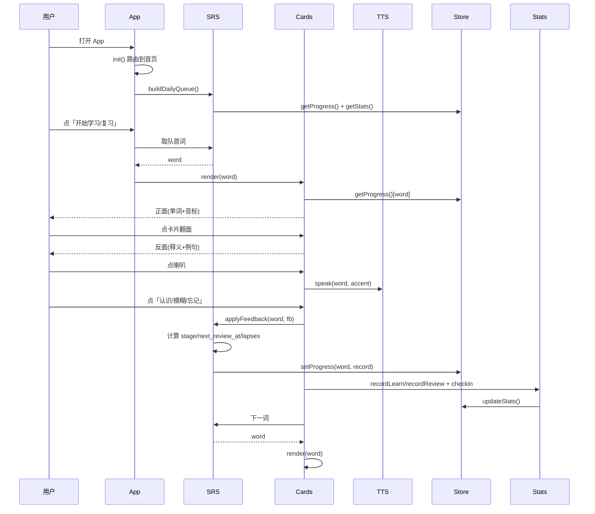
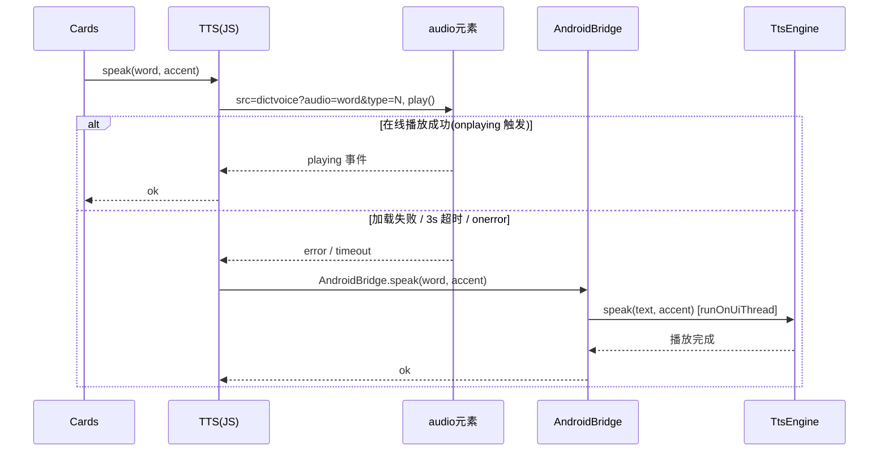
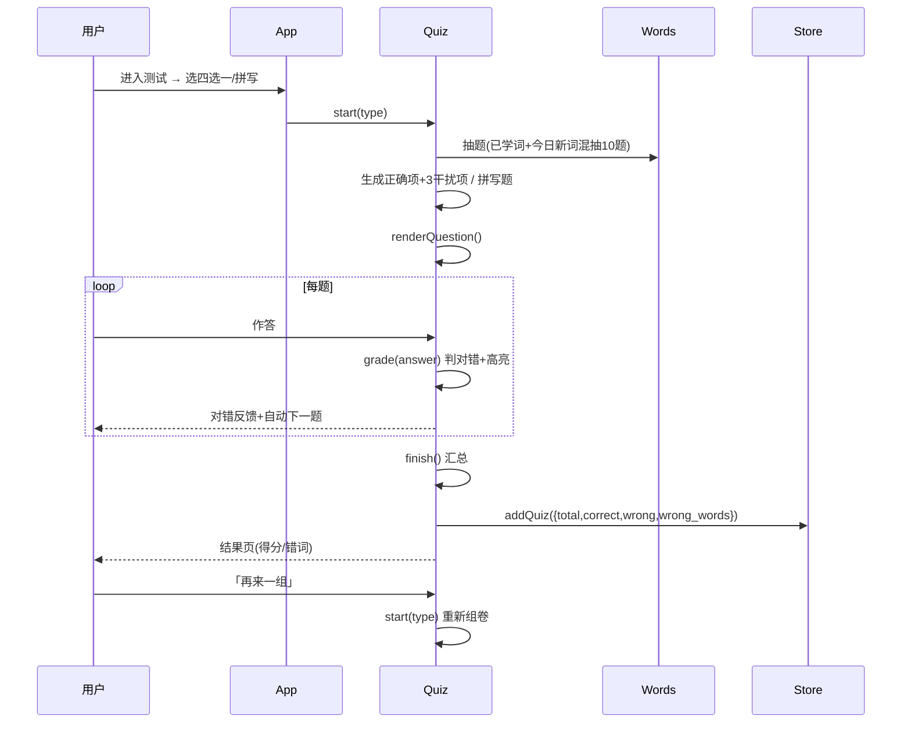
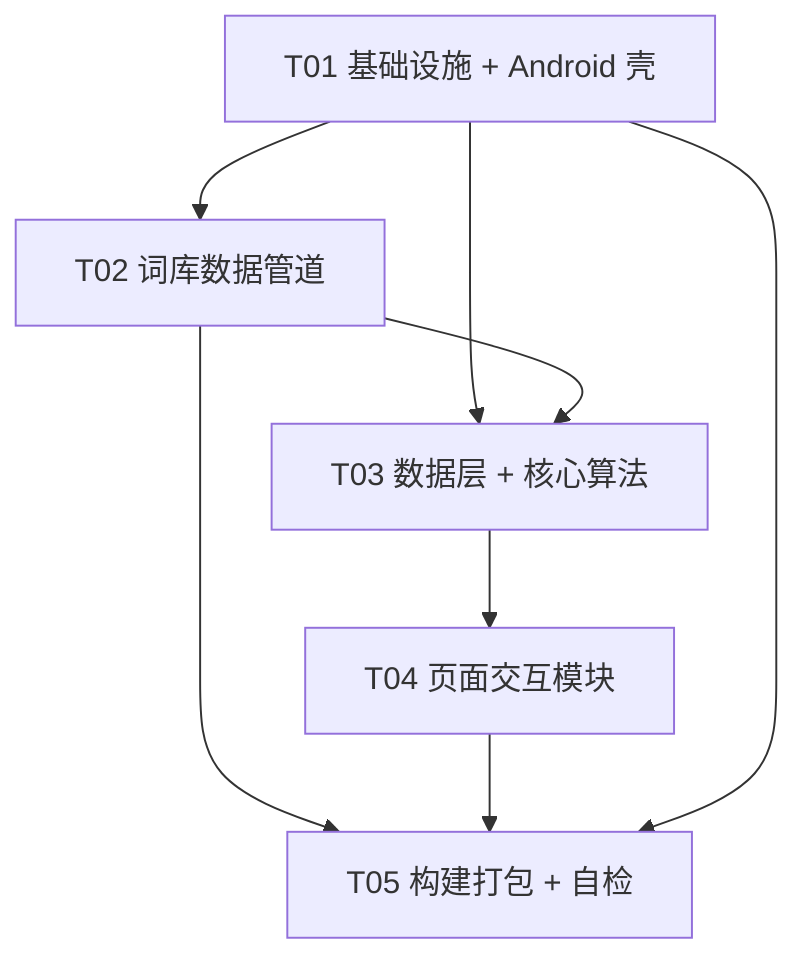

# 四级背单词 App —— 系统架构设计与任务分解

> 作者：zhanghiz
> 上游输入：`docs/PRD.md`、已验证骨架 `D:\AndroidProjects\DayPlan`
> 项目形态：安卓 WebView 混合应用（离线 HTML/CSS/JS + 零依赖纯 Java 单 Activity）

---

## 0. 设计结论速览（TL;DR）

| 决策点 | 结论 |
| --- | --- |
| 前端形态 | 单页多 view（6 页 + 底部 5 入口），纯 HTML/CSS/JS 打包在 `assets/www/` |
| 外壳 | 复制 `DayPlan` 已验证骨架：虚拟域名 `cet4words.local` + `shouldInterceptRequest` 喂 assets + 兜底 `file://` + `setDomStorageEnabled` |
| JS Bridge | `addJavascriptInterface`，对象名 `AndroidBridge`，方法 `speak(text, accent)` / `appVersion()` / `toast(msg)` / `saveFile(name, content)` |
| 发音 | 有道 `dictvoice`（`<audio>`）优先 → 失败/断网回退系统 `TextToSpeech`（Bridge 走 `runOnUiThread`） |
| 词库内嵌 | **`data/cet4.js`**（`window.CET4_WORDS = [...]`，`<script>` 引入），**不用 json + fetch** |
| 词库字段 | `word` / `phonetic_us` / `phonetic_uk` / `trans` / `definition` / `sentences`；**speech 字段省略，由 word 推导** |
| 持久化 | localStorage，统一前缀 `cet4.`，6 个 key（进度/生词本/测试/统计/设置/范文标记） |
| 复习算法 | SM-2 简化版，三档反馈，stage 0~6，间隔 `0/1/2/4/7/15/30` 天 |
| 依赖 | **运行时零第三方**；仅 Gradle 插件 `com.android.application 8.4.0`（阿里云镜像） |
| 版本 | v1.0.0 → versionCode 10000；`appVersion()` 从 PackageInfo 读真实值 |

---

# 第一部分：系统设计

## 1. 实现方案 + 框架选型

### 1.1 核心技术难点与对策

| 难点 | 对策 |
| --- | --- |
| WebView 里 localStorage 不可靠（`file://` 下可能丢失） | 虚拟域名 `https://cet4words.local` + `shouldInterceptRequest` 把 `assets/www/*` 喂给 WebView，保证 localStorage 绑定到稳定 origin；`file://` 仅作拦截失败兜底 |
| 外壳零依赖、构建快、不踩坑 | 纯 `android.app.Activity`（不用 AndroidX / Kotlin），沿用 DayPlan 已验证代码骨架 |
| 断网也能发音 | 双通道：有道在线 `<audio>` → 失败/超时 → Java 壳 `TextToSpeech`（经 Bridge） |
| 4000+ 词内嵌体积控制 | 精简字段 + 每词 1 例句 + 省略可推导的 speech 字段 + 生成时无空白压缩 |
| 每日队列正确生成 | SM-2 简化版：复习（`next_review_at <= 今天`，按间隔升序）优先，再补新词 |
| 版本号一处失真 | 四处同步 + 运行时从 `PackageInfo.versionName` 读，不写死 |

### 1.2 前端文件划分（无打包器、`<script>` 顺序加载）

不引入任何 bundler / npm 依赖。每个 JS 文件向 `window` 挂一个全局对象，加载顺序由 `index.html` 中 `<script>` 标签固定：

```
data/cet4.js  → data/essays.js  → js/store.js → js/words.js → js/srs.js
→ js/tts.js → js/stats.js → js/cards.js → js/quiz.js → js/notebook.js
→ js/essay.js → js/settings.js → js/app.js（最后：路由 + 启动）
```

全局对象命名：`Store` / `Words` / `SRS` / `TTS` / `Stats` / `Cards` / `Quiz` / `Notebook` / `Essay` / `Settings` / `App`（PascalCase，每个模块一个文件）。

### 1.3 词库数据格式选型：`cet4.js` vs `json`

**选型：`data/cet4.js`，内容为 `window.CET4_WORDS = [ ... ];`，用 `<script>` 引入。**

理由：

1. **零异步**：`<script>` 同步解析，`Words.buildIndex()` 在启动时即可同步读到 `CET4_WORDS`，无需 `fetch().then()` 或加载态；避免 WebView 里 fetch 相对路径 / 缓存 / CORS 的坑。
2. **体积代价极小**：仅多 `window.CET4_WORDS=` 前缀（约 20 字节），可忽略。
3. **解析快**：JS 数组字面量由 V8/JavaScriptCore 原生解析，比 `JSON.parse` 多一次转字符串更省。
4. **一致**：范文数据 `essays.js` 同理用 `window.CET4_ESSAYS`，前端访问方式统一。

### 1.4 体积估算与控制

| 项 | 估算 |
| --- | --- |
| 单词语义数据（4000 词，压缩后无空白） | 约 220~280 字节/词 |
| `cet4.js` 总量 | **约 1.0~1.3 MB** |
| 入 APK 后（AAPT2 默认 deflate 压缩 assets） | 约 500~700 KB 贡献 |
| 预计 APK 总大小 | 约 2~3 MB（可控，无风险） |

控制手段（写入清洗脚本与共享知识）：

1. 每词只保留 **1 条例句**（取 `sentence.sentences[0]`）。
2. **省略 `speech_us` / `speech_uk`**（由 `word` 推导：`https://dict.youdao.com/dictvoice?audio=<word>&type=<1|2>`，字段与 word 强冗余）。
3. `definition` 为空时不输出该键（减小体积）。
4. 生成时 `json.dumps(ensure_ascii=False, separators=(',', ':'))` 去掉所有空白。
5. 备用优化（仅当体积仍超标时启用）：字段改短键 `w/us/uk/t/d/s`；首版**不启用**，保留字段可读性。

---

## 2. 完整文件列表

### 2.1 根目录配置

| 相对路径 | 职责 |
| --- | --- |
| `settings.gradle.kts` | 插件/依赖仓库走阿里云镜像，`rootProject.name="CET4Words"`，`include(":app")` |
| `build.gradle.kts` | 声明 `com.android.application 8.4.0 apply false` |
| `gradle.properties` | JVM 参数、`android.useAndroidX=false`、镜像超时、`GRADLE_USER_HOME` 缓存 |
| `local.properties` | `sdk.dir=D:/devtools/android-sdk`（**正斜杠**） |
| `build-apk.ps1` | 一键构建：设 JDK17/SDK/Gradle8.7/缓存环境变量、清代理、`assembleRelease` |
| `CHANGELOG.md` | 版本历史（v1.0.0） |
| `README.md` | 项目说明 + 构建步骤 + 数据来源 |
| `docs/PRD.md` | 产品需求（已存在） |
| `docs/ARCHITECTURE.md` | 本文档 |

### 2.2 App 配置

| 相对路径 | 职责 |
| --- | --- |
| `app/build.gradle.kts` | namespace/applicationId=`com.zhang.cet4words`、minSdk24/targetSdk34、versionCode10000/versionName1.0.0、release 用 debug 签名、Java17 |
| `app/src/main/AndroidManifest.xml` | 声明 `MainActivity` + `INTERNET` 权限（仅在线发音需要） |

### 2.3 Java 壳（包 `com.zhang.cet4words`）

| 相对路径 | 职责 |
| --- | --- |
| `app/src/main/java/com/zhang/cet4words/MainActivity.java` | WebView 壳：VHOST + `shouldInterceptRequest` 喂 assets + `file://` 兜底 + 注入 `AndroidBridge` + 返回键 `evaluateJavascript` + 版本号 |
| `app/src/main/java/com/zhang/cet4words/TtsEngine.java` | 系统 `TextToSpeech` 封装：init/speak/shutdown，全部主线程执行，处理"未就绪先入队" |
| `app/src/main/java/com/zhang/cet4words/FileExporter.java` | 备份 JSON 导出到系统"下载"目录（P1 数据导出，复用 DayPlan） |

### 2.4 资源

| 相对路径 | 职责 |
| --- | --- |
| `app/src/main/res/values/strings.xml` | `app_name = 四级背单词` |
| `app/src/main/res/values/themes.xml` | 白底 `Theme.Material.Light.NoActionBar`、状态栏白底黑字 |
| `app/src/main/res/drawable/ic_launcher_background.xml` | 图标背景（纯色） |
| `app/src/main/res/drawable/ic_launcher_foreground.xml` | 图标前景（线描"词"字形占位） |
| `app/src/main/res/mipmap-anydpi-v26/ic_launcher.xml` + `ic_launcher_round.xml` | 自适应图标（引用背景/前景） |
| `app/src/main/res/mipmap-{hdpi,mdpi,xhdpi,xxhdpi,xxxhdpi}/ic_launcher*.png` | 各密度占位 PNG（复制 DayPlan） |

### 2.5 前端（`assets/www/`）

| 相对路径 | 职责 |
| --- | --- |
| `index.html` | 单页入口：6 页结构 + 底部 5 入口导航 + `<script>` 引入顺序（见 §1.2） |
| `css/style.css` | 全局样式：CSS 变量（颜色/间距/圆角）、极简铁律、深色模式（P1）对比度变量 |
| `data/cet4.js` | `window.CET4_WORDS = [...]`（由脚本生成，不手写） |
| `data/essays.js` | `window.CET4_ESSAYS = [...]`（范文 + 好词好句，P1） |
| `js/store.js` | localStorage 封装：key 常量 + 6 类数据读写 + 导出/导入（JSON） |
| `js/words.js` | 词库加载、`Map` 索引、查询、简要中文释义、音标按口音取 |
| `js/srs.js` | SM-2 简化版：三档反馈 + 间隔表 + 每日队列生成 |
| `js/tts.js` | 发音双通道：有道在线 `<audio>` → 失败/超时回退 `AndroidBridge.speak` |
| `js/stats.js` | 学习统计 + 打卡 + 连续天数 |
| `js/cards.js` | 背词卡片页：翻面 / 发音 / 收藏 / 三档反馈 / 切词 |
| `js/quiz.js` | 四选一 + 拼写测试（组卷/判分/结果页） |
| `js/notebook.js` | 生词本（列表/移除/进卡片浏览） |
| `js/essay.js` | 范文背诵 + 好词好句（P1，标记已背） |
| `js/settings.js` | 设置页（发音偏好/每日目标/深色/导出） |
| `js/app.js` | 入口：路由 + 底部导航 + `onAndroidBack` + 启动初始化 |

### 2.6 工具 / 文档

| 相对路径 | 职责 |
| --- | --- |
| `tools/build_dict.py` | 下载 `kajweb/dict` CET4_1~3、解压、清洗、去重、精简、生成 `data/cet4.js` |
| `tools/verify_apk.py` | 用 `aapt2 dump badging` 核对 APK 的 versionCode/versionName（自检） |
| `docs/CHECKLIST.md` | 发布自检清单（版本四处同步 / 图标 / 权限 / 离线可用） |

> 文件总数约 38 个；其中手写代码文件约 30 个，`data/cet4.js` 为生成物。

---

## 3. 数据结构与接口

### 3.1 词库内嵌字段（`window.CET4_WORDS` 元素）

源字段 → 精简字段映射：

| 精简字段 | 类型 | 说明 | 源字段映射 |
| --- | --- | --- | --- |
| `word` | string | 单词，全局关联键，唯一 | `headWord` |
| `phonetic_us` | string | 美式音标 | `content.word.content.usphone` |
| `phonetic_uk` | string | 英式音标 | `content.word.content.ukphone` |
| `trans` | array | `[{pos, cn}]` 词性+中文释义（多词性多元素） | `content.word.content.trans[]` → `{pos, cn: tranCn}` |
| `definition` | string | 英文解释（可空，空则不输出该键） | `trans[]` 首个非空 `tranOther` |
| `sentences` | array | 例句，首版只 1 条 `[{en, cn}]`，可空数组 | `sentence.sentences[]` → `{en: sContent, cn: sCn}` 取第一条 |

> **speech 字段省略**：发音地址由 `word` 推导
> `US = https://dict.youdao.com/dictvoice?audio=<word>&type=2`
> `UK = https://dict.youdao.com/dictvoice?audio=<word>&type=1`
> （与源 `usspeech=word&type=2` / `ukspeech=word&type=1` 一致，type=2 美音 / type=1 英音）。

词条示例：

```json
{
  "word": "abandon",
  "phonetic_us": "ə'bændən",
  "phonetic_uk": "ə'bændən",
  "trans": [
    { "pos": "vt.", "cn": "放弃；抛弃" },
    { "pos": "n.", "cn": "放任；狂热" }
  ],
  "definition": "to leave someone or something completely",
  "sentences": [
    { "en": "He abandoned the plan.", "cn": "他放弃了这个计划。" }
  ]
}
```

### 3.2 localStorage 六类数据 schema

统一前缀 `cet4.`，全部为单个 JSON 字符串。`word` 为全局关联键。

**① 学习记录 `cet4.progress`**（对象，key=word）

```json
{
  "abandon": {
    "status": "learning",
    "stage": 2,
    "next_review_at": "2026-10-12",
    "lapses": 1,
    "last_review_at": "2026-10-10",
    "last_feedback": "fuzzy"
  }
}
```

| 字段 | 类型 | 说明 |
| --- | --- | --- |
| `status` | string | `new` / `learning` / `review` / `mastered` |
| `stage` | int | 0~6（见 §3.5） |
| `next_review_at` | string | `YYYY-MM-DD` 下次复习日 |
| `lapses` | int | 累计忘记次数 |
| `last_review_at` | string | 上次复习日 |
| `last_feedback` | string | `know` / `fuzzy` / `forgot` |

**② 生词本 `cet4.notebook`**（对象，key=word，插入序即展示序）

```json
{ "abandon": { "added_at": 1728560000000 } }
```

**③ 测试结果 `cet4.quiz_history`**（数组，新结果 append）

```json
[
  {
    "id": 1,
    "type": "choice",
    "created_at": 1728560000000,
    "total": 10,
    "correct": 8,
    "wrong": 2,
    "wrong_words": [
      { "word": "abandon", "user": "放弃；抛弃", "answer": "放任；狂热" }
    ]
  }
]
```

**④ 统计/打卡 `cet4.stats`**（单对象）

```json
{
  "total_learned": 120,
  "total_reviewed": 45,
  "streak_days": 3,
  "total_checkin_days": 7,
  "last_checkin_date": "2026-10-10",
  "daily_new_count": 12,
  "daily_review_count": 20
}
```

**⑤ 设置 `cet4.settings`**

```json
{ "accent": "us", "daily_new": 20, "theme": "light" }
```

| 字段 | 默认 | 说明 |
| --- | --- | --- |
| `accent` | `us` | `us` / `uk` |
| `daily_new` | `20` | 20 / 30 / 50 |
| `theme` | `light` | `light` / `dark`（P1） |

**⑥ 范文背诵标记 `cet4.essay_progress`**（对象，key=essay id）

```json
{ "essay_1": { "memorized": true, "updated_at": 1728560000000 } }
```

### 3.3 JS Bridge 接口（网页 ↔ Java）

对象名 `AndroidBridge`，由 `addJavascriptInterface(new Bridge(), "AndroidBridge")` 注入。**网页 → Java**（`@JavascriptInterface`，运行在子线程，涉 UI 必须 `runOnUiThread`）：

| 方法签名 | 返回 | 说明 |
| --- | --- | --- |
| `speak(String text, String accent)` | void | 系统 TTS 朗读，`accent`∈`{us,uk}`；内部 `runOnUiThread` 调 `TtsEngine` |
| `appVersion()` | String | 真实版本号，`getPackageInfo(...).versionName`，异常兜底 `"1.0.0"` |
| `toast(String msg)` | void | 原生短提示（可选，`runOnUiThread`） |
| `saveFile(String name, String content)` | String | 导出 JSON 到下载目录，返回 `ok:<path>` / `err:<msg>`（P1） |

**Java → 网页**（`evaluateJavascript`）：

| 触发 | JS 调用 |
| --- | --- |
| 返回键 | `window.onAndroidBack()`，返回 `true`=网页已处理（如翻面/关闭弹层），`false`=走"再按一次退出" |
| `onResume` | `document.dispatchEvent(new Event('visibilitychange'))` |

### 3.4 前端对象关系（classDiagram）

见 `docs/class-diagram.mermaid`（另存独立文件），核心关系：`App` 组装并驱动各模块；`Cards` 依赖 `SRS/Store/TTS/Stats`；`Quiz` 依赖 `Words/Store`；`TTS(JS)` 通过 `AndroidBridge.speak` 回退到 Java 的 `TtsEngine`。

### 3.5 SM-2 简化版参数

| stage | 间隔 |
| --- | --- |
| 0（新学当天） | 当天再出现 |
| 1 / 2 / 3 / 4 / 5 | 1 / 2 / 4 / 7 / 15 天 |
| 6（mastered） | 30 天（30 天满后移出常规复习） |

| 反馈 | 处理 |
| --- | --- |
| 认识 `know` | `stage+1`，`next_review_at = 今天 + 间隔(new stage)` |
| 模糊 `fuzzy` | `stage` 不变，`next_review_at = 今天 + 间隔(stage)` |
| 忘记 `forgot` | `stage=0`，`lapses+1`，`next_review_at = 今天`（当天再出现） |

每日队列：`复习队列 = 所有 next_review_at <= 今天`（按间隔升序）→ 若不足，按词书顺序补新词至 `daily_new`。复习优先于新词。

---

## 4. 程序调用流程（时序图）

三个关键流程（完整 mermaid 另存 `docs/sequence-diagram.mermaid`）：

### 4.1 背单词闭环（进入卡片 → 发音 → 反馈 → 写 localStorage → 更新队列）



### 4.2 发音回退（有道 → TTS）



回退判定：设置 3s 看门狗；若 `<audio>` 触发 `playing` 则在线成功、清看门狗；若 `error` 事件或 3s 内未 `playing`，则调用 `AndroidBridge.speak`。**同一单词只回退一次**，避免重复播。

### 4.3 测试流程



---

## 5. 待明确事项（不阻塞，已给默认值）

| # | 问题 | 默认值（按此实现） |
| --- | --- | --- |
| 1 | 例句保留策略 | 每词 1 句（取第一条）；无例句的词保留，`sentences=[]`，卡面显示"暂无例句" |
| 2 | `speech_us/uk` 是否内嵌 | **省略**，由 `word` 推导 URL；省约 150KB。若个别词发音 URL 不规则可后续单独保留 |
| 3 | 范文/好词好句数据来源 | 无公开结构化语料，P0 先内嵌占位空数组；P1 由内置内容硬编码 5 篇范文 + ~50 条好词好句到 `essays.js` |
| 4 | 每日新词量 | 默认 20（设置 20/30/50） |
| 5 | 测试题量 | 默认 10 题/组，来源"已学词 + 今日新词"混抽 |
| 6 | 默认发音 | 美音 `us` |
| 7 | minSdk | **24**（兼容 7.0，与 DayPlan 一致）；PRD Q8 曾写 26，以 24 为准，targetSdk 34 |
| 8 | 打卡判定 | 当日完成 ≥1 词（新学或复习）即打卡 |
| 9 | 深色模式 | 首版只浅色；深色 P1（对比度 ≥4.5:1 实算） |
| 10 | 词库脏数据 | 去重（按 word 小写）；剔除 usphone/ukphone 均空 或 trans 为空的词；法语字母归一化（é→e 等） |
| 11 | 有道 type 映射 | type=1=英音(UK)、type=2=美音(US)（与源 ukspeech/usspeech 一致，已确认） |
| 12 | 数据导入（P1） | 沿用 DayPlan `<input type=file>` + `onShowFileChooser`，导出走 `saveFile` |

---

# 第二部分：任务分解

## 6. 依赖包列表

**运行时依赖：零**（约束：不引 AndroidX / Kotlin / 第三方）。

| 类型 | 项 | 版本 |
| --- | --- | --- |
| Gradle 插件 | `com.android.application` | **8.4.0**（与 Gradle 8.7 兼容，DayPlan 已验证） |
| 仓库 | 阿里云镜像 | `maven.aliyun.com/repository/{gradle-plugin,google,central,public}` |
| 数据脚本 | Python 3 标准库 | 仅 `urllib/zipfile/json/re/argparse`，**无 pip 依赖** |

## 7. 任务列表（依赖顺序）

> 硬约束：≤5 个任务；每个任务 ≥3 文件；首个任务=基础设施；按功能模块/层次分组。

### T01 项目基础设施 + Android 壳（Gradle/Manifest/资源/图标 + WebView 壳）

- **源文件**：`settings.gradle.kts`、`build.gradle.kts`、`gradle.properties`、`local.properties`、`app/build.gradle.kts`、`app/src/main/AndroidManifest.xml`、`app/src/main/res/values/strings.xml`、`app/src/main/res/values/themes.xml`、图标资源（drawable + mipmap-*）、`app/src/main/java/com/zhang/cet4words/MainActivity.java`、`TtsEngine.java`、`FileExporter.java`、`build-apk.ps1`、`app/src/main/assets/www/index.html`（6 页骨架 + 导航 + script 引入顺序）、`app/src/main/assets/www/css/style.css`（基线）
- **依赖**：无
- **优先级**：P0

### T02 词库数据管道（下载/清洗/精简/生成内嵌数据）

- **源文件**：`tools/build_dict.py`、`app/src/main/assets/www/data/cet4.js`（生成）、`app/src/main/assets/www/data/essays.js`（范文占位）
- **依赖**：T01（确定 assets 目录与 `index.html` 的 `<script>` 引入位置）
- **优先级**：P0

### T03 数据层 + 核心算法（持久化 + 索引 + SRS + 发音 + 统计）

- **源文件**：`js/store.js`、`js/words.js`、`js/srs.js`、`js/tts.js`、`js/stats.js`
- **依赖**：T01（script 顺序与页面骨架）、T02（词库字段契约）
- **优先级**：P0

### T04 页面交互模块（卡片/测试/生词本/范文/设置/路由 + 样式完善）

- **源文件**：`js/cards.js`、`js/quiz.js`、`js/notebook.js`、`js/essay.js`、`js/settings.js`、`js/app.js`（路由/导航/返回键/启动）、`css/style.css`（完善）、`index.html`（细化）
- **依赖**：T03（Store/SRS/TTS/Stats/Words 已就绪）
- **优先级**：P0

### T05 构建打包 + 版本同步 + 自检

- **源文件**：`CHANGELOG.md`、`README.md`、`tools/verify_apk.py`、`docs/CHECKLIST.md`（执行 `build-apk.ps1` 构建 + aapt2 核对 versionCode/versionName + 功能自检）
- **依赖**：T01、T02、T03、T04
- **优先级**：P0

## 8. 共享知识（跨文件约定）

```
- 全局命名：JS 模块用 PascalCase 全局对象（Store/Words/SRS/TTS/Stats/Cards/Quiz/Notebook/Essay/Settings/App）；Java 包 com.zhang.cet4words
- 词库访问：window.CET4_WORDS（数组，顺序=词书顺序=新词学习顺序）；window.CET4_ESSAYS（范文）
- 发音接口常量：US=https://dict.youdao.com/dictvoice?audio={word}&type=2 ; UK=...&type=1
- localStorage key 常量：cet4.progress / cet4.notebook / cet4.quiz_history / cet4.stats / cet4.settings / cet4.essay_progress（统一走 Store，禁止散落裸 key）
- 日期格式：YYYY-MM-DD（本地时区）；打卡/复习判定按当天日期字符串比较
- 打卡规则：当日完成≥1词即打卡；streak 增量算法——last_checkin_date==昨天→+1，==今天→不变，否则重置=1
- 颜色变量（浅色基线）：--bg #FFFFFF / --fg #111111 / --line #E5E5E5 / --muted #666666 / --accent #1A6DF0（深色 P1 需实算对比度≥4.5:1）
- UI 铁律：白底黑字、1px 分隔线、圆角 4~6px、零阴影/渐变/霓虹、线描 SVG(stroke 1.9, fill none)、禁 emoji、动效 100~150ms linear 或硬切、中文用系统字体栈
- SVG 图标：内联 <svg viewBox="0 0 24 24" fill="none" stroke="currentColor" stroke-width="1.9" stroke-linecap="round" stroke-linejoin="round">，颜色跟随 currentColor
- 版本：versionCode = MAJOR*10000 + MINOR*100 + PATCH（v1.0.0→10000）；build.gradle.kts/CHANGELOG/发布页/aapt2 四处同步；关于页走 appVersion() 读真实值
- 构建环境：JAVA_HOME=D:\devtools\jdk-17、ANDROID_HOME=D:\devtools\android-sdk、GRADLE_USER_HOME=D:\devtools\gradle-home、Gradle=D:\devtools\gradle-8.7\bin\gradle.bat；构建前清 HTTP(S)_PROXY
- WebView 关键设置：setJavaScriptEnabled/setDomStorageEnabled(true) 必开；setAllowFileAccess(true) 仅兜底；setMediaPlaybackRequiresUserGesture(true)（发音均为用户手势触发）
```

## 9. 任务依赖图


